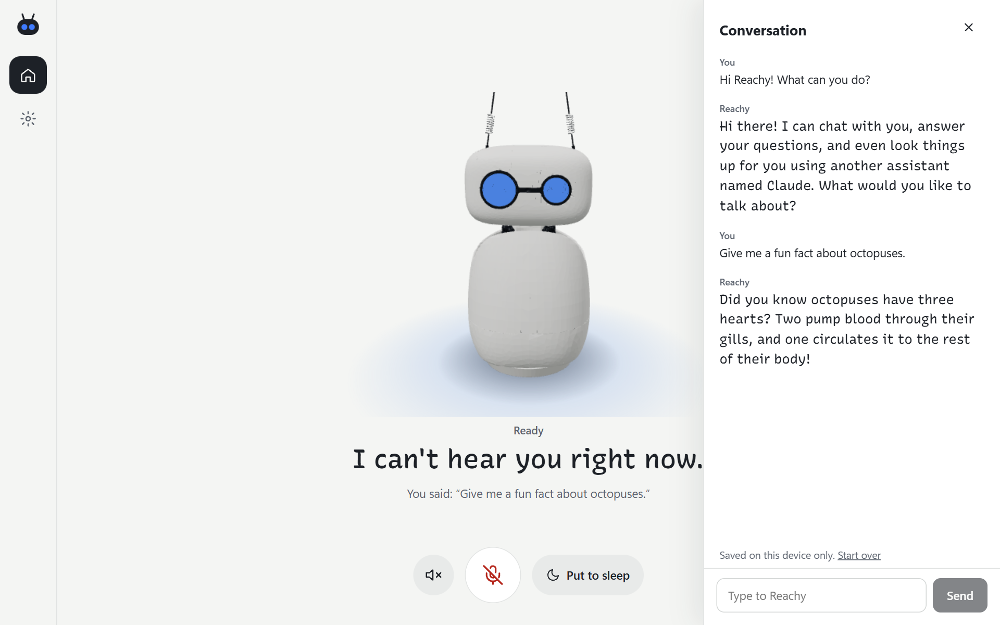

# Everything Agent

Talk with your [Reachy Mini](https://www.pollen-robotics.com/reachy-mini/) the way you'd talk
with a person: no wake word, no button. It listens, answers out loud, moves its head while it
speaks, and stops when you talk over it.



The same app runs in three places:

- **On the robot** (Reachy Mini Wireless, on its Raspberry Pi), started from the robot's dashboard.
- **On a laptop** (Windows or macOS) as a desktop app, with the robot plugged in over USB, or
  without a robot at all, using the laptop's microphone and speaker.
- **In any browser** on your network, for the robot or the laptop: the same screens as the desktop app.

This is the first step of a bigger assistant. It does one thing, conversation, and does it
well; tools and integrations are meant to be added on top, one at a time.

## What you need

Two API keys, entered on the setup screen the first time you open the app:

| What for | Service | Get a key |
| --- | --- | --- |
| Hearing and speaking | [Cartesia](https://cartesia.ai) (speech to text and voices) | [play.cartesia.ai/keys](https://play.cartesia.ai/keys) |
| Thinking | [OpenRouter](https://openrouter.ai), or any OpenAI-compatible provider, or a local [Ollama](https://ollama.com) | [openrouter.ai/keys](https://openrouter.ai/keys) |

Keys stay on the device the app runs on.

Optional: [Claude Code](https://claude.com/claude-code), installed and signed in on the same
machine (run `claude` once; on the robot, `claude setup-token`). Reachy then hands hard
questions to it, see [Hard questions go to Claude](#hard-questions-go-to-claude).

## Install

### On the robot (Reachy Mini Wireless)

Install it into the robot's apps from a terminal on the robot (the dashboard's app store
lists it once it's published there):

```bash
pip install git+https://github.com/curious-pm/Everything-Agent
```

Start it from the dashboard, then open `http://reachy-mini.local:8042` on your phone or
laptop. The first visit asks you to choose a PIN, then for the two keys. On the robot, Reachy
uses its own microphone (with hardware echo cancelling) and speaker.

### Desktop app (Windows, macOS)

Download the installer from the [Releases](../../releases) page: the `.exe` for Windows, the
`.dmg` for macOS. It starts the robot software for you: with Reachy plugged in over USB it uses
the robot, and without it, your computer's microphone and speaker.

The installers aren't code-signed yet. On Windows, if SmartScreen says "Windows protected your
PC", choose **More info → Run anyway**; on macOS, right-click the app and choose **Open** the
first time.

### From source, on a laptop

```bash
git clone https://github.com/curious-pm/Everything-Agent && cd Everything-Agent
uv sync --extra dev                            # or: python -m venv .venv && pip install -e ".[dev]"
uv run reachy-mini-daemon --mockup-sim         # in another terminal; plain `reachy-mini-daemon` with the robot
uv run python -m everything_agent
```

Then open <http://127.0.0.1:8042>.

## How it works

```
 microphone ─▶ loudness check ─▶ Cartesia speech-to-text (streaming)
                                        │  you stopped talking (550 ms of silence,
                                        ▼  longer after "and", "um", a trailing comma)
                              language model (streaming)
                                        │  each finished sentence
                                        ▼
                              Cartesia voice (streaming) ─▶ speaker + head wobble
```

Everything streams, which is what keeps it fast:

- **Speech to text only runs while someone talks.** A local loudness check opens the
  connection on the first word, and the audio from just before is kept, so nothing is
  clipped. After a minute of quiet it closes, so an idle robot costs nothing.
- **Reachy starts speaking after the first sentence**, not the whole reply.
- **Connections stay warm.** The model's connection is kept open between turns and refreshed
  while you talk; the voice socket stays open for the whole conversation.
- **Turn-taking is forgiving.** If you pause and carry on before Reachy has started
  answering, it drops that answer and replies to everything you said together.
- **Talking over Reachy** (if switched on) first turns its voice down, then stops it if
  you keep talking. Its own voice fades with it; yours doesn't.

Reachy starts speaking about one second, plus the model's own response time, after your last
word. The model is the biggest part: Gemini 2.5 Flash through OpenRouter takes 1.3 to 2
seconds to start answering, so replies begin 2.5 to 3 seconds after you stop. A provider
close to you (for example Groq, or Gemini's own endpoint) cuts that; set it under
Settings → Advanced. Every reply's timing is in the log as a `Timing:` line.

### Hard questions go to Claude

The model is offered tools (`src/everything_agent/tools/`). The first is `ask_claude`: when a
question needs the web or careful thinking, the model hands it to Claude Code (`claude -p`)
running in the background and says it's looking into it. Claude's answer is spoken as soon as
it's ready, usually 10 to 30 seconds later; the conversation carries on meanwhile.

Claude runs in Claude Code's restricted mode: it may search the web, fetch pages and read
files, but never edit or run anything, and it ignores your own Claude Code settings and MCP
servers. It reads files only in the folders you list in `CLAUDE_CODE_FOLDERS` (none by default),
never credential files, and it can't see this app's keys. It's on whenever Claude Code is
installed; switch it off under Settings → Advanced. It uses your own Claude Code sign-in, so
its questions count toward your own Claude plan or API usage.

New tools subclass `Tool` and are listed in `tools.available()`. A tool either returns a
result the model then answers with, or (like `ask_claude`) works in the background and speaks
through `announce`.

### Project layout

```
src/everything_agent/
  main.py             Reachy Mini app entry point (what the robot's launcher starts)
  runtime.py          keeps the web page up; starts and restarts the conversation
  conversation/       the loop: listening, turn-taking, replies, history
  audio/              microphone reader, speaker playback, interruption detection
  voice/              Cartesia speech-to-text and voice, the language model client
  tools/              what the model can do besides talking (ask_claude)
  server/             web API, PIN sign-in, the setup checks
  robot.py            the SDK: microphone, speaker, idle head motion, sleep and wake
  desktop/            the desktop app's core: runs the robot software and the app
  web/                the built web UI (committed, so installs from git work)
ui/                   the React UI (same screens on web and desktop)
desktop/              the Tauri desktop shell (window, tray, start at login)
packaging/            PyInstaller recipe for the desktop app's core, and its license collector
docs/                 screenshots
index.html, style.css the app's page in the Reachy Mini app store (a Hugging Face Space)
```

## Develop

```bash
uv sync --extra dev
uv run pytest                                   # Python tests
cd ui && npm ci && npm test              # UI tests
npm run dev                              # UI with hot reload, talking to a running app on :8042
```

Build the desktop app (Windows: `scripts\build_desktop.ps1`, macOS: `scripts/build_desktop.sh`).
It builds the UI, packs the Python core with PyInstaller into `desktop/src-tauri/core/`,
and bundles it into the installer. A debug shell (`cd desktop && npx tauri dev`) runs the
core from the repository's `.venv` instead.

## Settings

Everything the app's Settings page changes lives in one `.env` file:
`%LOCALAPPDATA%\everything_agent\.env` on Windows,
`~/Library/Application Support/everything_agent/.env` on macOS and `~/.config/everything_agent/.env`
on Linux and the robot. See [.env.example](.env.example) for every option. Forgot the PIN?
Delete the `WEB_PIN_HASH` line and restart; the next visit sets a new one.

## Security

- The web page asks for a PIN (6 characters or more). Wrong PINs lock that device out for five
  minutes after five tries, and everyone out after 30 wrong tries in an hour. Changing the PIN
  from a browser needs the current one.
- On the robot, the first visitor chooses the PIN, so open the page yourself right after
  installing. In the desktop app only its own window can set the first PIN.
- The page is plain HTTP on your local network: use it on networks you trust.
- Anyone who can talk to Reachy can ask Claude things. Claude can't change anything on the
  computer, but it can read the folders you share with it and fetch web pages, so share only
  folders you're happy for anyone in the room to ask about.
- Report security problems privately to the maintainers rather than in a public issue.

## License

Apache-2.0; see [LICENSE](LICENSE) and [NOTICE](NOTICE). The desktop installers also contain
third-party software under its own licenses, listed in `THIRD_PARTY_LICENSES.txt` inside the app.

Everything Agent is an independent project, not affiliated with or endorsed by Pollen Robotics,
Hugging Face or Anthropic. Reachy Mini is a robot by Pollen Robotics and Hugging Face, and this
app is built on its open-source SDK. Claude and Claude Code are trademarks of Anthropic, PBC.
